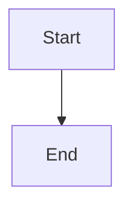
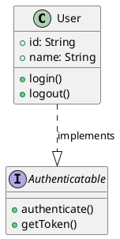
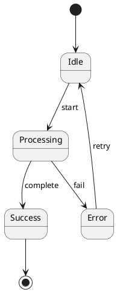
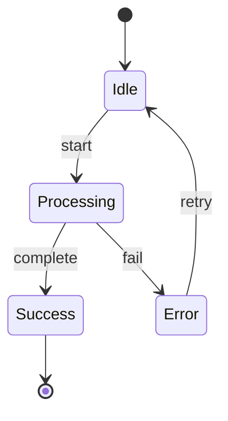

# convert2mermaid

[](https://www.npmjs.com/package/convert2mermaid)
[](https://opensource.org/licenses/MIT)

<p align="center">
  <a href="README.md">English</a> |
  <a href="README.zh.md">简体中文</a>
</p>

Convert diagrams from Visio, DrawIO, Excalidraw, and PlantUML into [Mermaid](https://mermaid.js.org/) syntax. The project can be used as a command-line converter or imported as an npm package by other Node.js/TypeScript modules.

It is useful for keeping diagrams in version control, generating Mermaid blocks for Markdown documentation, and migrating existing diagram files into a text-based format.

## Features

- **Multiple input formats**: `.vsdx`, `.drawio`, `.excalidraw`, `.puml`, and `.plantuml`
- **Multiple Mermaid targets**: `flowchart`, `classDiagram`, `sequenceDiagram`, `stateDiagram-v2`, `block-beta`, `erDiagram`, `gantt`, `mindmap`, and `timeline`
- **CLI and npm package usage**: run conversions from the terminal or call the parser/generator from application code
- **TypeScript declarations**: package exports include generated `.d.ts` files
- **Diagram type detection**: source files are analyzed with confidence scores before Mermaid generation
- **DrawIO flowchart fallback**: ambiguous DrawIO diagrams can fall back to Mermaid `flowchart`
- **Shape and style preservation**: labels, common shapes, colors, line styles, arrows, and fills are preserved where possible

## Installation

Install as a dependency:

```bash
npm install convert2mermaid
```

Install globally if you want the `convert2mermaid` command available in your shell:

```bash
npm install -g convert2mermaid
```

For local development:

```bash
git clone https://github.com/jgreywolf/convert2mermaid.git
cd convert2mermaid
npm install
npm run build
```

## Quick Start

After installing globally or using the built package:

```bash
convert2mermaid -i input.drawio -o output.mmd
```

From this repository:

```bash
# Run the built CLI. Requires npm run build first.
npm start -- -i tests/drawio.drawio -f mmd

# Run TypeScript source during development.
npm run dev -- -i tests/drawio.drawio -f md

# Call the built CLI directly.
node dist/cli.js -i tests/drawio.drawio -o tests/drawio.mmd
```

If `--outputFile` is not provided, the output path is derived from the input filename and `--outputFormat`.

## Command Line Usage

```text
convert2mermaid [options]

Required:
  -i, --inputFile <path>                 Input diagram file

Optional:
  -o, --outputFile <path>                Output file path
  -f, --outputFormat <mmd|md>            Output format, defaults to mmd
  -d, --diagramType <type>               Reserved for explicit diagram type usage
  -ffc, --fallbackFlowchartConfidence    DrawIO fallback threshold, defaults to 50
```

### DrawIO Fallback Threshold

`-ffc` / `--fallbackFlowchartConfidence` controls how DrawIO type detection handles ambiguous diagrams.

DrawIO files often contain generic rectangles, ellipses, text, and arrows without explicit semantic metadata. When a specialized type such as class, component, sequence, state, ER, or network is detected below the configured confidence percentage, the converter uses Mermaid `flowchart` instead. This usually produces more renderable output because Mermaid flowcharts tolerate generic node/edge structures better than specialized diagram syntaxes.

Examples:

```bash
# Default fallback threshold: 50
convert2mermaid -i diagram.drawio -o diagram.mmd

# Require stronger specialized detection before leaving flowchart mode
convert2mermaid -i diagram.drawio -o diagram.mmd -ffc 70

# Allow weaker specialized detection
convert2mermaid -i diagram.drawio -o diagram.mmd -ffc 30
```

## Library Usage

The package exports parser and generator helpers from `dist/index.js`.

```ts
import { convertToMermaid, parseDiagram, generateMermaidCode } from 'convert2mermaid';

const result = await convertToMermaid('diagram.drawio', {
  outputFormat: 'mmd',
  fallbackFlowchartConfidence: 50,
});

console.log(result.mermaid);
console.log(result.analysis?.detectedType);
console.log(result.analysis?.confidence);

const parsed = await parseDiagram('diagram.drawio');

if (parsed) {
  const mermaid = generateMermaidCode(parsed);
  console.log(mermaid);
}
```

### API Reference

#### `convertToMermaid(filepath, options?)`

Parses a source file, generates Mermaid syntax, and returns the diagram model, Mermaid output, and optional detection analysis.

```ts
const result = await convertToMermaid('diagram.puml', {
  outputFormat: 'md',
  fallbackFlowchartConfidence: 60,
});
```

Options:

```ts
{
  outputFormat?: 'mmd' | 'md';
  fallbackFlowchartConfidence?: number;
  silent?: boolean;
}
```

Returns:

```ts
{
  diagram: Diagram;
  mermaid: string;
  analysis?: DiagramAnalysis;
}
```

#### `parseDiagram(filepath, options?)`

Parses a source file and returns the internal diagram model without generating Mermaid.

```ts
const diagram = await parseDiagram('diagram.drawio', {
  fallbackFlowchartConfidence: 50,
});
```

#### `generateMermaidCode(diagram)`

Generates Mermaid syntax from an already parsed diagram object.

#### `parseData(filepath, options?)`

Lower-level parser entry point used internally by the CLI and API. Most callers should prefer `parseDiagram` or `convertToMermaid`.

## Supported Formats

### DrawIO `.drawio`

Supported targets:

- **Flowcharts**: process flows, decisions, documents, databases, data stores, manual inputs, and generic connected shapes
- **Class diagrams**: UML-style classes, attributes, methods, stereotypes, and relationships
- **Sequence diagrams**: actors, participants, lifelines, messages, activation-like regions, and frame labels such as `par`, `alt`, `loop`, and `opt`
- **State diagrams**: states, transitions, initial states, final states, and basic state labels
- **Component diagrams**: components, modules, packages, containers, and dependencies
- **Entity-relationship diagrams**: entities, attributes, relationships, and cardinality-like labels
- **Network diagrams**: network devices, server-like nodes, cloud nodes, and infrastructure connections

DrawIO detection is heuristic. It reads structured `mxCell` data including labels, styles, edge relationships, geometry, parent/child grouping, and shape hints. Some shapes are semantically useful, for example `umlActor`, `umlLifeline`, `startState`, `endState`, `module`, `component`, `entity`, and Cisco/network shapes. Generic rectangles and arrows are intentionally handled conservatively.

Supported shape categories include:

- Basic: rectangles, rounded rectangles, circles, ellipses, diamonds, triangles, hexagons
- Flowchart: process, decision, document, database, delay, display, manual input, stored data
- UML: actors, lifelines, frames, notes, components, modules
- Specialized: cylinders, parallelograms, trapezoids, clouds, paper tape, network device shapes

Examples:

```bash
# Generic DrawIO diagram
convert2mermaid -i diagram.drawio -o diagram.mmd

# DrawIO to Markdown with a Mermaid code block
convert2mermaid -i diagram.drawio -o diagram.md -f md

# Raise fallback threshold for ambiguous DrawIO files
convert2mermaid -i diagram.drawio -o diagram.mmd -ffc 80
```

### PlantUML `.puml`, `.plantuml`

Supported targets:

- **Class diagrams**: classes, interfaces, abstract classes, enumerations, attributes, methods, visibility modifiers, stereotypes, and UML relationships
- **Component diagrams**: components, packages, databases, nodes, and dependency-style relationships
- **State diagrams**: states, transitions, initial/final states, and common transition labels
- **Sequence diagrams**: participants, actors, messages, activations, and common message arrows
- **Use case diagrams**: actors, use cases, include/extend-style relationships
- **Activity diagrams**: activities, decisions, start/stop nodes, and simple flows
- **Gantt charts**: basic tasks, milestones, and durations

Common UML relationship mappings include:

- `--|>` inheritance
- `..|>` implementation
- `o--` aggregation
- `*--` composition
- `-->` association/dependency-style links

Examples:

```bash
convert2mermaid -i class-model.puml -o class-model.mmd
convert2mermaid -i sequence.puml -o sequence.md -f md
convert2mermaid -i architecture.plantuml -o architecture.mmd
```

### Visio `.vsdx`

Visio support focuses on basic shape and connector conversion:

- Flowchart-like pages
- Basic diagrams with shapes and connectors
- Text labels on shapes and connectors
- Basic style preservation where the parser exposes useful metadata

Example:

```bash
convert2mermaid -i flowchart.vsdx -o flowchart.mmd
```

### Excalidraw `.excalidraw`

Excalidraw support focuses on sketch-style diagrams:

- Rectangles, diamonds, ellipses, and other basic elements
- Connectors and arrows
- Text label extraction
- Flowchart-style Mermaid output

Example:

```bash
convert2mermaid -i sketch.excalidraw -o sketch.mmd
```

## Detection Engine

The detection layer analyzes diagram content before generation and attaches analysis metadata to the parsed diagram.

Detection considers:

- File type and parser result
- Shape styles and semantic shape names
- Edge count, direction, and connectivity
- Labels that look like UML members, stereotypes, participants, states, or ER attributes
- Parent/child grouping such as swimlanes, containers, packages, and modules
- Known PlantUML directives such as `@startuml` and `@startgantt`

Example CLI output:

```text
Detected diagram type: flowchart (35% confidence)

Detection evidence:
  - flowchart: Found generic nodes and directed edges (35%)

Diagram metadata: 4 shapes, 3 edges
```

For DrawIO, unknown or low-confidence specialized detections can fall back to `flowchart` through the `fallbackFlowchartConfidence` option.

## Output Formats

### `.mmd`

Writes raw Mermaid syntax:



### `.md`

Writes a Markdown file containing a Mermaid fenced code block:

````markdown

````

### Mermaid Syntax Generated

- Flowcharts: `flowchart TD` or `flowchart LR`
- Class diagrams: `classDiagram`
- Sequence diagrams: `sequenceDiagram`
- State diagrams: `stateDiagram-v2`
- Component diagrams: `block-beta`
- ER diagrams: `erDiagram`
- Gantt charts: `gantt`
- Mind maps: `mindmap`
- Timelines: `timeline`

## Advanced Usage

### Convert Multiple Files

PowerShell:

```powershell
Get-ChildItem diagrams -Filter *.drawio | ForEach-Object {
  convert2mermaid -i $_.FullName -o "output/$($_.BaseName).mmd"
}
```

Bash:

```bash
for file in diagrams/*.puml; do
  convert2mermaid -i "$file" -o "output/$(basename "$file" .puml).mmd"
done
```

### Use in Build Scripts

```json
{
  "scripts": {
    "diagrams": "convert2mermaid -i docs/architecture.drawio -o docs/architecture.mmd"
  }
}
```

### Programmatic Conversion

```ts
import { writeFile } from 'node:fs/promises';
import { convertToMermaid } from 'convert2mermaid';

const { mermaid, analysis } = await convertToMermaid('docs/architecture.drawio', {
  outputFormat: 'mmd',
  fallbackFlowchartConfidence: 70,
});

console.log(`Detected ${analysis?.detectedType} at ${analysis?.confidence}%`);
await writeFile('docs/architecture.mmd', mermaid);
```

## Development

```bash
npm install
npm run build
npm test
npm run test:watch
npm run dev -- -i tests/drawio.drawio -f mmd
```

Package validation:

```bash
npm pack --dry-run --json
```

`npm pack` and `npm publish` run `npm run build` first through the `prepack` script.

## Project Structure

```text
src/
├── index.ts                 Public package exports
├── api.ts                   Library API: convertToMermaid, parseDiagram, generateMermaidCode
├── cli.ts                   Command-line entry used by the package bin
├── scribe.ts                Dispatches parsed diagrams to Mermaid generators
├── types.d.ts               Shared diagram model types
├── parser/                  Format-specific parsers and parser dispatcher
│   ├── BaseParser.ts        Shared parser base behavior
│   ├── parser.ts            File extension dispatch and parseData entry point
│   ├── drawioParser.ts      DrawIO XML parser
│   ├── plantumlParser.ts    PlantUML text parser
│   └── excalidrawParser.ts  Excalidraw JSON parser
├── detection/               Diagram type detection
│   ├── DetectorFactory.ts   Reads files and routes to the right detector
│   ├── DiagramDetector.ts   Shared detection logic and common scoring
│   ├── DrawIODetector.ts    DrawIO-specific heuristics and flowchart fallback
│   ├── PlantUMLDetector.ts  PlantUML-specific heuristics
│   ├── types.ts             Detection result and option types
│   └── index.ts             Detection exports
├── generators/              Mermaid syntax generators
│   ├── flowchartGenerator.ts
│   ├── classGenerator.ts
│   ├── sequenceGenerator.ts
│   ├── stateGenerator.ts
│   ├── componentGenerator.ts
│   ├── erGenerator.ts
│   ├── ganttGenerator.ts
│   ├── mindmapGenerator.ts
│   ├── networkGenerator.ts
│   └── timelineGenerator.ts
├── shapes/                  Shape mappings and Mermaid shape helpers
│   ├── flowchartShapes.ts
│   └── shapeMappers.ts
└── utils/                   Shared utility functions
    ├── classUtils.ts
    ├── errorUtils.ts
    ├── labelUtils.ts
    ├── relationshipUtils.ts
    └── styleUtils.ts
```

Test files live next to the code they validate and use the `*.spec.ts` suffix.

## Examples

### PlantUML Class Diagram

Input:



Output:

```mermaid
classDiagram
  class User {
    +id: String
    +name: String
    +login()
    +logout()
  }
  class Authenticatable
  <<interface>> Authenticatable {
    +authenticate()
    +getToken()
  }
  User ..|> Authenticatable : implements
```

### PlantUML State Diagram

Input:



Output:



## Known Limitations

1. DrawIO does not always store explicit diagram type metadata, so detection is heuristic.
2. Generic DrawIO shapes are ambiguous and may intentionally fall back to `flowchart`.
3. Mermaid layout is not coordinate-based like DrawIO, Visio, or Excalidraw, so exact visual positioning is not preserved.
4. Multi-page diagrams are not fully supported.
5. Very complex PlantUML syntax may need manual adjustment after conversion.
6. Gantt support is basic; advanced PlantUML Gantt features such as sections and date formatting may need additional work.

## Contributing

Contributions are welcome.

1. Fork the repository.
2. Create a feature branch.
3. Add focused tests for behavior changes.
4. Run `npm run build` and `npm test`.
5. Open a pull request.

## License

MIT. See [LICENSE](LICENSE).

## Acknowledgments

- Built with [TypeScript](https://www.typescriptlang.org/)
- Mermaid syntax targets [Mermaid.js](https://mermaid.js.org/)
- Uses [vsdx-js](https://github.com/jgreywolf/vsdx-js) for Visio parsing
- XML parsing with [xml2js](https://github.com/Leonidas-from-XIV/node-xml2js)
- CLI built with [commander](https://github.com/tj/commander.js)
- Tests run with [Vitest](https://vitest.dev/)
