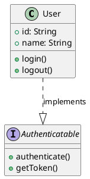
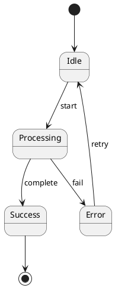
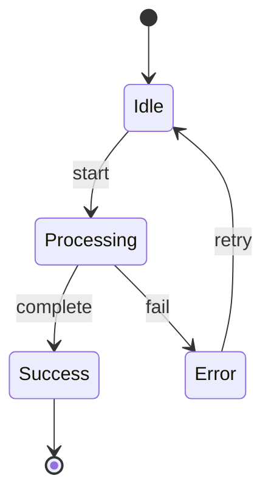

# convert2mermaid

[](https://www.npmjs.com/package/convert2mermaid)
[](https://opensource.org/licenses/MIT)

<p align="center">
  <a href="README.md">English</a> |
  <a href="README.zh.md">简体中文</a>
</p>

一款强大的命令行工具，可将多种图表格式（Visio、DrawIO、Excalidraw、PlantUML）转换为 [Mermaid](https://mermaid.js.org/) 语法。非常适合在版本控制中维护文档、为 Markdown 文件生成图表，以及将传统图表转换为现代格式。

## 功能特性

-   **通用格式支持**：支持从 Visio、DrawIO、Excalidraw 和 PlantUML 转换
-   **智能检测**：通过置信度评分自动识别图表类型
-   **丰富的图表类型**：支持流程图、类图、序列图、状态图等多种类型
-   **样式保留**：保留颜色、线条样式、箭头和形状类型
-   **命令行界面**：简洁易用的 CLI 工具
-   **充分测试**：54 个以上测试用例全部通过，保证向后兼容

## 安装

```bash
# 克隆仓库
git clone https://github.com/jgreywolf/convert2mermaid.git
cd convert2mermaid

# 安装依赖
npm install

# 构建项目
npm run build
```

## 快速开始

```bash
# 直接以 TypeScript 代码运行调试（不需要构建）

npm start -- -i tests/classDiagram_kanban_board.drawio -f md

# 基础转换
node ./dist/index.js -i input-diagram.drawio -o output.mmd

# 自动检测输出文件名
node ./dist/index.js -i my-diagram.puml

# 指定输出格式（默认为 .mmd）
node ./dist/index.js -i diagram.vsdx -o result.md -f md
```

## 使用说明

### 命令行选项

```bash
node ./dist/index.js [options]

必需参数：
  -i, --inputFile <path>        输入图表文件路径

可选参数：
  -o, --outputFile <path>       输出文件路径（默认为输入文件名 + .mmd 后缀）
  -f, --format <format>         输出格式：'mmd' 或 'md'（默认为 'mmd'）
  -d, --diagramType <type>      强制指定图表类型（通常会自动检测）
```

## 支持的格式

### Excalidraw (.excalidraw)

**支持的图表类型：**

-   ✅ 流程图
-   ✅ 包含形状和连接器的基本图表

**功能特点：**

-   形状类型识别（矩形、圆形、菱形等）
-   连接器/箭头保留
-   文本标签提取
-   尽可能保留手绘风格

**示例：**

```bash
node ./dist/index.js -i sketch.excalidraw -o output.mmd
```

---

### DrawIO (.drawio)

**支持的图表类型：**

-   ✅ **流程图** - 流程处理、决策树
-   ✅ **类图** - 含属性和方法的 UML 类
-   ✅ **序列图** - 生命线、参与者、消息、激活框、框架（par/alt/loop/opt）
-   ✅ **状态图** - 状态、转换、初始/终止状态
-   ✅ **组件图** - 组件、包、依赖关系
-   ✅ **实体关系图** - 实体、关系、属性
-   ✅ **网络图** - 网络节点、连接、基础设施

**功能特点：**

-   **泳道聚合** - 自动合并泳道内的类成员
-   **高级形状映射** - 支持 50 多种形状类型
-   **样式保留** - 颜色、线条样式、箭头、填充
-   **UML 标记支持** - 构造型（<<接口>>、<<抽象>>）
-   **HTML 实体解码** - 正确处理格式化内容
-   **激活框** - 序列图激活区域
-   **框架检测** - 识别 par、alt、loop、opt 结构

**支持的形状：**

-   基础：矩形、圆形、椭圆、菱形、三角形、六边形
-   流程图：流程、决策、文档、数据库、延迟、显示、手动输入、存储数据
-   UML：参与者、生命线、框架、注释
-   专用：圆柱体、平行四边形、梯形、云形、纸带

**示例：**

```bash
# 带泳道的类图
node ./dist/index.js -i class-diagram.drawio -o classes.mmd

# 含参与者和消息的序列图
node ./dist/index.js -i sequence.drawio -o sequence.mmd

# 状态图
node ./dist/index.js -i state-machine.drawio -o states.mmd
```

---

### PlantUML (.puml, .plantuml)

**支持的图表类型：**

-   ✅ **类图** - 类、接口、抽象类、枚举
-   ✅ **组件图** - 组件、包、数据库
-   ✅ **状态图** - 状态、转换、初始/终止状态
-   ✅ **用例图** - 参与者、用例、include/extend 关系
-   ✅ **序列图** - 参与者、角色、消息、激活
-   ✅ **活动图** - 活动、决策、开始/结束节点
-   ✅ **甘特图** - 任务、里程碑、持续时间（基础支持）

**功能特点：**

-   **完整的 UML 标记支持**：
    -   可见性修饰符：`+`（公开）、`-`（私有）、`#`（保护）、`~`（包）
    -   关系类型：`--|>`（继承）、`..|>`（实现）、`o--`（聚合）、`*--`（组合）
    -   构造型：`<<interface>>`、`<<abstract>>`、`<<enumeration>>`
-   **模块化解析器架构** - 每种图表类型都有专用的解析逻辑
-   **智能类型检测** - 分析内容和指令（@startuml、@startgantt）
-   **全面的关系处理** - 支持所有 UML 关系类型及基数

**类图输出：**
转换为 Mermaid `classDiagram` 语法，使用正确的 UML 标记

**组件图输出：**
转换为 Mermaid `block-beta` 语法

**状态图输出：**
转换为 Mermaid `stateDiagram-v2` 语法

**示例：**

```bash
# 含完整 UML 标记的类图
node ./dist/index.js -i class-model.puml -o classes.mmd

# 组件架构图
node ./dist/index.js -i architecture.puml -o components.mmd

# 状态机
node ./dist/index.js -i state-machine.puml -o states.mmd

# 序列图
node ./dist/index.js -i sequence.puml -o sequence.mmd

# 用例图
node ./dist/index.js -i use-cases.puml -o usecases.mmd
```

---

### Visio (.vsdx)

**支持的图表类型：**

-   ✅ **流程图** - 基础流程处理
-   ✅ **基本图表** - 形状和连接器

**功能特点：**

-   形状和连接器转换
-   文本标签提取
-   基础样式保留

**示例：**

```bash
node ./dist/index.js -i flowchart.vsdx -o output.mmd
```

## 智能检测引擎

该工具内置智能图表类型检测系统：

-   **置信度评分** - 每次检测都包含一个置信度百分比
-   **多模式分析** - 检查形状、关系和流程模式
-   **内容感知解析** - 识别 UML 关系、构造型、时序序列
-   **自动格式检测** - 从文件内容中识别图表类型

**检测输出示例：**

```
Detected diagram type: class (95% confidence)

Detection evidence:
  - class: Found @startuml directive, Found explicit class diagram directive (95%)

Diagram metadata: 40 shapes, 12 edges
```

## 输出格式

### 生成的 Mermaid 语法

根据检测到的图表类型，工具会生成相应的 Mermaid 语法：

-   **类图** → `classDiagram`
-   **状态图** → `stateDiagram-v2`
-   **组件图** → `block-beta`
-   **序列图** → `sequenceDiagram`
-   **流程图** → `flowchart TD` / `flowchart LR`
-   **ER 图** → `erDiagram`
-   **甘特图** → `gantt`
-   **思维导图** → `mindmap`
-   **时间线** → `timeline`

### 输出文件格式

-   `.mmd` - 纯 Mermaid 语法
-   `.md` - 带 Mermaid 代码块的 Markdown 文件

## 高级用法

### 强制指定图表类型

```bash
node ./dist/index.js -i diagram.drawio -o output.mmd -d class
```

### 批量转换

```bash
# 转换目录中所有的 PlantUML 文件
for file in diagrams/*.puml; do
  node ./dist/index.js -i "$file" -o "output/$(basename "$file" .puml).mmd"
done
```

### 在脚本中使用

```bash
#!/bin/bash
# 转换并提交图表
node ./dist/index.js -i architecture.drawio -o docs/architecture.mmd
git add docs/architecture.mmd
git commit -m "更新架构图"
```

## 测试

```bash
# 运行所有测试
npm test

# 监听模式运行测试
npm run test:watch

# 运行指定的测试文件
npm test -- src/parser/plantumlParser.spec.ts
```

## 项目架构

该工具采用模块化架构：

```
src/
├── index.ts                 # CLI 入口
├── parser/                  # 各格式解析器
│   ├── drawioParser.ts      # DrawIO XML 解析器
│   ├── plantumlParser.ts    # PlantUML 文本解析器
│   ├── excalidrawParser.ts  # Excalidraw JSON 解析器
│   └── visioParser.ts       # Visio VSDX 解析器
├── generators/              # Mermaid 语法生成器
│   ├── classDiagramGenerator.ts
│   ├── stateDiagramGenerator.ts
│   ├── blockDiagramGenerator.ts
│   └── flowchartGenerator.ts
├── detection/               # 智能图表类型检测
│   ├── DrawIODetector.ts
│   ├── PlantUMLDetector.ts
│   └── DiagramDetector.ts
├── utils/                   # 工具函数
│   ├── labelUtils.ts
│   ├── classUtils.ts
│   ├── relationshipUtils.ts
│   └── styleUtils.ts
└── shapes/                  # 形状类型映射
    └── flowchartShapes.ts
```

## 示例

### 示例 1：类图转换

**输入（PlantUML）：**



**输出（Mermaid）：**

```mermaid
classDiagram
  class User {
    +id: String
    +name: String
    +login()
    +logout()
  }
  class Authenticatable
  <<interface>> Authenticatable {
    +authenticate()
    +getToken()
  }
  User ..|> Authenticatable : implements
```

### 示例 2：状态图转换

**输入（PlantUML）：**



**输出（Mermaid）：**



## 已知限制

1. **PlantUML 用例检测**：全局检测器可能将用例图识别为序列图（解析器处理正确）
2. **甘特图语法**：基础支持；完整的 PlantUML 甘特图语法（sections、dateFormat）仍需增强
3. **深层嵌套**：非常深的嵌套结构可能需要手动调整
4. **多页图表**：目前每个文件只处理单个页面/图表

## 未来规划

### 高优先级

-   [ ] 完整的 PlantUML 甘特图语法支持
-   [ ] 多页图表支持
-   [ ] 增强用例检测

### 中优先级

-   [ ] Lucidchart 支持
-   [ ] 状态图中的复合状态
-   [ ] 对象图
-   [ ] 部署图

### 低优先级

-   [ ] Gliffy 支持
-   [ ] 时序图
-   [ ] 网络图增强

## 参与贡献

欢迎贡献代码！请随时提交 Pull Request。

1. Fork 仓库
2. 创建特性分支（`git checkout -b feature/amazing-feature`）
3. 提交更改（`git commit -m '添加某功能'`）
4. 推送到分支（`git push origin feature/amazing-feature`）
5. 发起 Pull Request

## 许可证

本项目采用 MIT 许可证 - 详情请参见 LICENSE 文件。

## 致谢

-   基于 [TypeScript](https://www.typescriptlang.org/) 构建
-   由 [Mermaid.js](https://mermaid.js.org/) 驱动
-   使用 [vsdx-js](https://github.com/jgreywolf/vsdx-js) 进行 Visio 解析
-   使用 [xml2js](https://github.com/Leonidas-from-XIV/node-xml2js) 进行 XML 解析
-   使用 [Vitest](https://vitest.dev/) 进行测试

## 联系方式

-   GitHub: [@jgreywolf](https://github.com/jgreywolf)
-   Issues: [GitHub Issues](https://github.com/jgreywolf/convert2mermaid/issues)

## 统计数据

-   **支持格式**：4 种（Visio、DrawIO、Excalidraw、PlantUML）
-   **图表类型**：所有格式共计 15 种以上
-   **形状映射**：50 种以上形状类型
-   **测试覆盖**：54 个以上测试用例
-   **依赖项**：优化至 144 个包（减少 65%）
