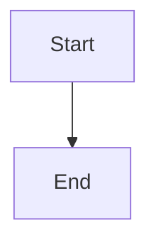
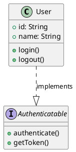
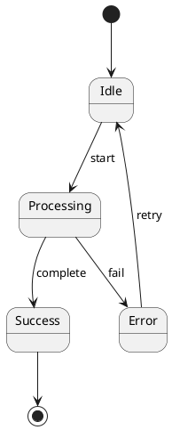
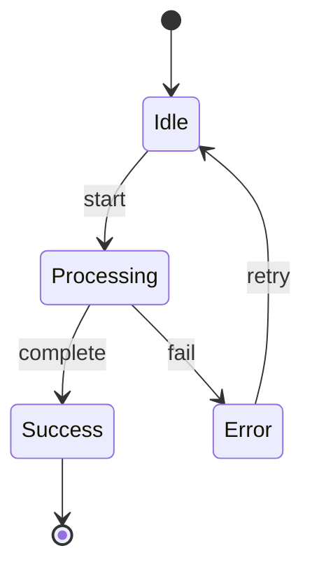

# convert2mermaid

[](https://www.npmjs.com/package/convert2mermaid)
[](https://opensource.org/licenses/MIT)

<p align="center">
  <a href="README.md">English</a> |
  <a href="README.zh.md">简体中文</a>
</p>

将 Visio、DrawIO、Excalidraw、PlantUML 等格式的图转换为 [Mermaid](https://mermaid.js.org/) 语法。这个项目既可以作为命令行转换工具使用，也可以作为 npm 包被其他 Node.js/TypeScript 模块引入。

它适合用于把图表纳入版本控制、为 Markdown 文档生成 Mermaid 代码块，以及把已有图形文件迁移为文本化的图表格式。

## 功能特性

- **多种输入格式**：支持 `.vsdx`、`.drawio`、`.excalidraw`、`.puml`、`.plantuml`
- **多种 Mermaid 目标语法**：支持 `flowchart`、`classDiagram`、`sequenceDiagram`、`stateDiagram-v2`、`block-beta`、`erDiagram`、`gantt`、`mindmap`、`timeline`
- **同时支持 CLI 和 npm 包**：可以在终端运行，也可以在应用代码中调用解析和生成方法
- **TypeScript 类型声明**：npm 包会导出生成后的 `.d.ts` 文件
- **图类型检测**：生成前会分析源文件，并记录检测类型和置信度
- **DrawIO 流程图回退**：DrawIO 图类型不明确时可回退为 Mermaid `flowchart`
- **形状和样式保留**：尽量保留标签、常见形状、颜色、线型、箭头和填充

## 安装

作为依赖安装：

```bash
npm install convert2mermaid
```

如果希望在命令行中直接使用 `convert2mermaid` 命令，可以全局安装：

```bash
npm install -g convert2mermaid
```

本地开发：

```bash
git clone https://github.com/jgreywolf/convert2mermaid.git
cd convert2mermaid
npm install
npm run build
```

## 快速开始

全局安装或使用构建后的包：

```bash
convert2mermaid -i input.drawio -o output.mmd
```

在本仓库中使用：

```bash
# 运行构建后的 CLI。需要先执行 npm run build。
npm start -- -i tests/drawio.drawio -f mmd

# 开发时直接运行 TypeScript 源码。
npm run dev -- -i tests/drawio.drawio -f md

# 直接调用构建后的 CLI。
node dist/cli.js -i tests/drawio.drawio -o tests/drawio.mmd
```

如果没有提供 `--outputFile`，输出路径会根据输入文件名和 `--outputFormat` 自动生成。

## 命令行用法

```text
convert2mermaid [options]

必需参数：
  -i, --inputFile <path>                 输入图文件

可选参数：
  -o, --outputFile <path>                输出文件路径
  -f, --outputFormat <mmd|md>            输出格式，默认 mmd
  -d, --diagramType <type>               预留参数，用于显式图类型
  -ffc, --fallbackFlowchartConfidence    DrawIO 回退阈值，默认 50
```

### DrawIO 回退阈值

`-ffc` / `--fallbackFlowchartConfidence` 用于控制 DrawIO 图类型检测遇到模糊图形时的处理方式。

DrawIO 文件里经常只有普通矩形、椭圆、文本和箭头，并没有明确的图类型语义。当类图、组件图、序列图、状态图、ER 图、网络图等专用类型的检测置信度低于这个百分比时，转换器会改用 Mermaid `flowchart`。这通常更容易渲染成功，因为 Mermaid flowchart 对普通节点和连线结构更宽容。

示例：

```bash
# 默认回退阈值：50
convert2mermaid -i diagram.drawio -o diagram.mmd

# 专用图类型需要更高置信度，否则回退为 flowchart
convert2mermaid -i diagram.drawio -o diagram.mmd -ffc 70

# 允许较低置信度也进入专用图类型生成
convert2mermaid -i diagram.drawio -o diagram.mmd -ffc 30
```

## 作为 npm 包使用

包入口会从 `dist/index.js` 导出解析和生成方法。

```ts
import { convertToMermaid, parseDiagram, generateMermaidCode } from 'convert2mermaid';

const result = await convertToMermaid('diagram.drawio', {
  outputFormat: 'mmd',
  fallbackFlowchartConfidence: 50,
});

console.log(result.mermaid);
console.log(result.analysis?.detectedType);
console.log(result.analysis?.confidence);

const parsed = await parseDiagram('diagram.drawio');

if (parsed) {
  const mermaid = generateMermaidCode(parsed);
  console.log(mermaid);
}
```

### API 说明

#### `convertToMermaid(filepath, options?)`

解析源文件，生成 Mermaid 语法，并返回图模型、Mermaid 输出和可选的检测分析结果。

```ts
const result = await convertToMermaid('diagram.puml', {
  outputFormat: 'md',
  fallbackFlowchartConfidence: 60,
});
```

参数：

```ts
{
  outputFormat?: 'mmd' | 'md';
  fallbackFlowchartConfidence?: number;
  silent?: boolean;
}
```

返回值：

```ts
{
  diagram: Diagram;
  mermaid: string;
  analysis?: DiagramAnalysis;
}
```

#### `parseDiagram(filepath, options?)`

只解析源文件，返回内部图模型，不生成 Mermaid。

```ts
const diagram = await parseDiagram('diagram.drawio', {
  fallbackFlowchartConfidence: 50,
});
```

#### `generateMermaidCode(diagram)`

基于已经解析好的图模型生成 Mermaid 语法。

#### `parseData(filepath, options?)`

底层解析入口，CLI 和 API 内部会使用它。大多数调用方优先使用 `parseDiagram` 或 `convertToMermaid`。

## 支持格式

### DrawIO `.drawio`

支持的目标类型：

- **流程图**：流程、判断、文档、数据库、数据存储、手动输入、普通连线形状
- **类图**：UML 类、属性、方法、构造型和关系
- **序列图**：参与者、生命线、消息、类似激活区域的结构，以及 `par`、`alt`、`loop`、`opt` 等框架标签
- **状态图**：状态、转换、初始状态、终止状态和基础状态标签
- **组件图**：组件、模块、包、容器和依赖关系
- **实体关系图**：实体、属性、关系和类似基数的标签
- **网络图**：网络设备、服务器节点、云节点和基础设施连接

DrawIO 检测是启发式的。它会读取结构化的 `mxCell` 数据，包括标签、样式、边关系、几何信息、父子分组和形状提示。有些形状语义比较明确，例如 `umlActor`、`umlLifeline`、`startState`、`endState`、`module`、`component`、`entity`、Cisco/网络设备形状等。普通矩形和箭头没有明确语义，因此会保守处理。

支持的形状类别包括：

- 基础形状：矩形、圆角矩形、圆形、椭圆、菱形、三角形、六边形
- 流程图形状：流程、判断、文档、数据库、延迟、显示、手动输入、数据存储
- UML 形状：参与者、生命线、框架、注释、组件、模块
- 专用形状：圆柱体、平行四边形、梯形、云形、纸带、网络设备形状

示例：

```bash
# 普通 DrawIO 图
convert2mermaid -i diagram.drawio -o diagram.mmd

# DrawIO 转 Markdown Mermaid 代码块
convert2mermaid -i diagram.drawio -o diagram.md -f md

# 提高 DrawIO 模糊图形的回退阈值
convert2mermaid -i diagram.drawio -o diagram.mmd -ffc 80
```

### PlantUML `.puml`、`.plantuml`

支持的目标类型：

- **类图**：类、接口、抽象类、枚举、属性、方法、可见性修饰符、构造型和 UML 关系
- **组件图**：组件、包、数据库、节点和依赖关系
- **状态图**：状态、转换、初始/终止状态和常见转换标签
- **序列图**：参与者、角色、消息、激活和常见消息箭头
- **用例图**：参与者、用例、include/extend 风格关系
- **活动图**：活动、判断、开始/结束节点和简单流程
- **甘特图**：基础任务、里程碑和持续时间

常见 UML 关系映射：

- `--|>` 继承
- `..|>` 实现
- `o--` 聚合
- `*--` 组合
- `-->` 关联或依赖风格连接

示例：

```bash
convert2mermaid -i class-model.puml -o class-model.mmd
convert2mermaid -i sequence.puml -o sequence.md -f md
convert2mermaid -i architecture.plantuml -o architecture.mmd
```

### Visio `.vsdx`

Visio 支持重点是基础形状和连接线转换：

- 类流程图页面
- 包含形状和连接线的基础图
- 形状和连接线上的文本标签
- 在解析器暴露可用元数据时尽量保留基础样式

示例：

```bash
convert2mermaid -i flowchart.vsdx -o flowchart.mmd
```

### Excalidraw `.excalidraw`

Excalidraw 支持重点是草图风格图形：

- 矩形、菱形、椭圆和其他基础元素
- 连接线和箭头
- 文本标签提取
- 流程图风格 Mermaid 输出

示例：

```bash
convert2mermaid -i sketch.excalidraw -o sketch.mmd
```

## 检测引擎

检测层会在生成前分析图内容，并把分析结果挂到解析后的图模型上。

检测会参考：

- 文件类型和解析器结果
- 形状样式和语义化形状名称
- 边数量、方向和连接关系
- 类似 UML 成员、构造型、参与者、状态、ER 属性的标签
- 泳道、容器、包、模块等父子分组
- `@startuml`、`@startgantt` 等 PlantUML 指令

CLI 输出示例：

```text
Detected diagram type: flowchart (35% confidence)

Detection evidence:
  - flowchart: Found generic nodes and directed edges (35%)

Diagram metadata: 4 shapes, 3 edges
```

对于 DrawIO，未知或低置信度的专用图类型可以通过 `fallbackFlowchartConfidence` 回退为 `flowchart`。

## 输出格式

### `.mmd`

输出纯 Mermaid 语法：



### `.md`

输出包含 Mermaid fenced code block 的 Markdown 文件：

````markdown

````

### 生成的 Mermaid 语法

- 流程图：`flowchart TD` 或 `flowchart LR`
- 类图：`classDiagram`
- 序列图：`sequenceDiagram`
- 状态图：`stateDiagram-v2`
- 组件图：`block-beta`
- ER 图：`erDiagram`
- 甘特图：`gantt`
- 思维导图：`mindmap`
- 时间线：`timeline`

## 高级用法

### 批量转换

PowerShell：

```powershell
Get-ChildItem diagrams -Filter *.drawio | ForEach-Object {
  convert2mermaid -i $_.FullName -o "output/$($_.BaseName).mmd"
}
```

Bash：

```bash
for file in diagrams/*.puml; do
  convert2mermaid -i "$file" -o "output/$(basename "$file" .puml).mmd"
done
```

### 在构建脚本中使用

```json
{
  "scripts": {
    "diagrams": "convert2mermaid -i docs/architecture.drawio -o docs/architecture.mmd"
  }
}
```

### 代码中转换

```ts
import { writeFile } from 'node:fs/promises';
import { convertToMermaid } from 'convert2mermaid';

const { mermaid, analysis } = await convertToMermaid('docs/architecture.drawio', {
  outputFormat: 'mmd',
  fallbackFlowchartConfidence: 70,
});

console.log(`Detected ${analysis?.detectedType} at ${analysis?.confidence}%`);
await writeFile('docs/architecture.mmd', mermaid);
```

## 开发

```bash
npm install
npm run build
npm test
npm run test:watch
npm run dev -- -i tests/drawio.drawio -f mmd
```

包内容验证：

```bash
npm pack --dry-run --json
```

`npm pack` 和 `npm publish` 会通过 `prepack` 脚本先执行 `npm run build`。

## 项目结构

```text
src/
├── index.ts                 npm 包公共导出
├── api.ts                   库 API：convertToMermaid、parseDiagram、generateMermaidCode
├── cli.ts                   命令行入口，也是 package bin 使用的入口
├── scribe.ts                根据图类型分发到 Mermaid 生成器
├── types.d.ts               共享图模型类型
├── parser/                  各格式解析器和解析分发器
│   ├── BaseParser.ts        解析器共享基础逻辑
│   ├── parser.ts            文件扩展名分发和 parseData 入口
│   ├── drawioParser.ts      DrawIO XML 解析器
│   ├── plantumlParser.ts    PlantUML 文本解析器
│   └── excalidrawParser.ts  Excalidraw JSON 解析器
├── detection/               图类型检测
│   ├── DetectorFactory.ts   读取文件并路由到对应检测器
│   ├── DiagramDetector.ts   通用检测逻辑和基础评分
│   ├── DrawIODetector.ts    DrawIO 专用启发式规则和 flowchart 回退
│   ├── PlantUMLDetector.ts  PlantUML 专用启发式规则
│   ├── types.ts             检测结果和选项类型
│   └── index.ts             检测模块导出
├── generators/              Mermaid 语法生成器
│   ├── flowchartGenerator.ts
│   ├── classGenerator.ts
│   ├── sequenceGenerator.ts
│   ├── stateGenerator.ts
│   ├── componentGenerator.ts
│   ├── erGenerator.ts
│   ├── ganttGenerator.ts
│   ├── mindmapGenerator.ts
│   ├── networkGenerator.ts
│   └── timelineGenerator.ts
├── shapes/                  形状映射和 Mermaid 形状辅助逻辑
│   ├── flowchartShapes.ts
│   └── shapeMappers.ts
└── utils/                   通用工具函数
    ├── classUtils.ts
    ├── errorUtils.ts
    ├── labelUtils.ts
    ├── relationshipUtils.ts
    └── styleUtils.ts
```

测试文件和对应代码放在一起，使用 `*.spec.ts` 后缀。

## 示例

### PlantUML 类图

输入：



输出：

```mermaid
classDiagram
  class User {
    +id: String
    +name: String
    +login()
    +logout()
  }
  class Authenticatable
  <<interface>> Authenticatable {
    +authenticate()
    +getToken()
  }
  User ..|> Authenticatable : implements
```

### PlantUML 状态图

输入：



输出：



## 已知限制

1. DrawIO 不一定保存明确的图类型元数据，因此检测是启发式的。
2. 普通 DrawIO 形状语义模糊，可能会有意回退为 `flowchart`。
3. Mermaid 布局不是 DrawIO、Visio、Excalidraw 那种坐标布局，因此不能保证完全保留原图位置。
4. 暂不完整支持多页图。
5. 很复杂的 PlantUML 语法可能需要转换后手动调整。
6. 甘特图支持较基础；PlantUML 甘特图里的 section、dateFormat 等高级能力可能还需要继续完善。

## 参与贡献

欢迎贡献代码。

1. Fork 仓库。
2. 创建功能分支。
3. 为行为变更添加聚焦的测试。
4. 运行 `npm run build` 和 `npm test`。
5. 提交 Pull Request。

## 许可证

MIT。详见 [LICENSE](LICENSE)。

## 致谢

- 基于 [TypeScript](https://www.typescriptlang.org/) 构建
- Mermaid 语法目标为 [Mermaid.js](https://mermaid.js.org/)
- 使用 [vsdx-js](https://github.com/jgreywolf/vsdx-js) 解析 Visio
- 使用 [xml2js](https://github.com/Leonidas-from-XIV/node-xml2js) 解析 XML
- CLI 基于 [commander](https://github.com/tj/commander.js)
- 测试基于 [Vitest](https://vitest.dev/)
